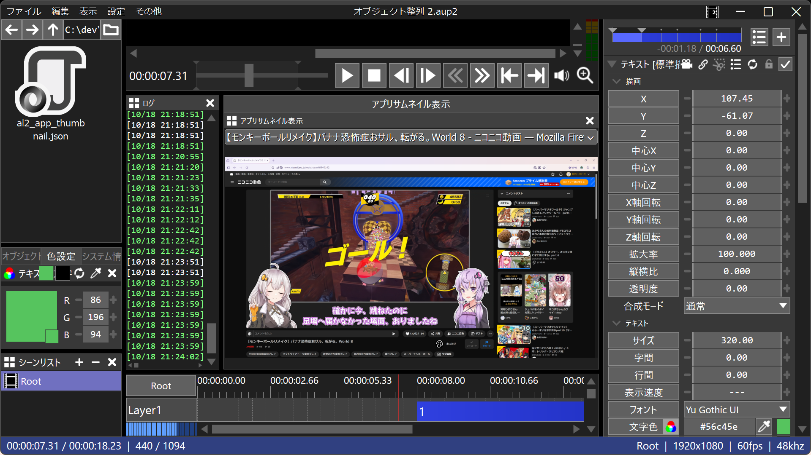

# 🐍AviUtl2 アプリサムネイル表示プラグイン

* aviutl2内に他のアプリのサムネイルを表示するプラグインです。

## 🚀インストール

* `プラグインフォルダ`に以下のファイルを入れてください。
	* `al2` ✏️フォルダ
		* `al2_app_thumbnail.aux2` ✏️汎用プラグインファイル

## 🔥アンインストール

* `プラグインフォルダ`から以下のファイルを削除してください。
	* `al2` ✏️フォルダ
		* `al2_app_thumbnail.aux2` ✏️このファイルを削除
		* `al2_app_thumbnail` ✏️このフォルダを削除

## 💡使い方

1. aviutl2ウィンドウのメニューで`表示`➡`アプリサムネイル表示`を選択します。
1. `アプリサムネイル表示`ウィンドウが表示されます。
1. `アプリサムネイル表示`ウィンドウ上部のコンボボックスで表示するアプリを選択します。
1. コンボボックスの下にあるエリアに他のアプリのサムネイルが表示されます。
---
* サムネイルは子ウィンドウではなくポップアップウィンドウなので、操作性に注意してください。
* firefoxの場合は、youtubeやニコニコの動画がリアルタイムで表示されるようです。

## 🔖更新履歴

* 🔖r1 2026年10月18日
	* 🎉初版
